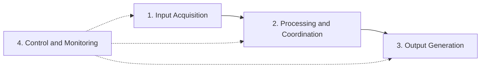

<div align="center">

# Group 44 · Operating Systems Project

**Process coordination, resource management, and modular system design, built as a team.**

<br />

[](.)
[](.)
[](.)
[](https://github.com/)

[Overview](#overview) •
[Concepts](#os-concepts-covered) •
[Architecture](#system-architecture) •
[Getting Started](#getting-started) •
[Team](#team) •
[Report](#documentation)

</div>

---

## Overview

This project applies Operating Systems theory to a working system. Group 44 built it for a university course, with a focus on how a system coordinates concurrent processes, shares resources safely, and stays modular enough to maintain.

| | Pillar | Description |
|---|---|---|
| 🔄 | **Process Coordination** | Managing concurrent processes and how they interact |
| 🧩 | **Modular Design** | Independent, reusable components with clear boundaries |
| 🤝 | **Collaboration** | Team development through Git branches and pull requests |

## OS Concepts Covered

| Concept | What we applied |
|---|---|
| **Process Management** | Scheduling and coordination of processes |
| **Resource Allocation** | Sharing resources, with deadlock awareness |
| **Synchronization** | Keeping concurrent processes safe |
| **I/O Handling** | Input and output flow control |
| **Modularization** | Separating the system into independent components |

## System Architecture

The system is split into four layers that run in sequence, with monitoring watching the whole pipeline.



| Layer | Responsibility |
|---|---|
| **Input Acquisition** | Collects and validates incoming data or requests |
| **Processing and Coordination** | Schedules work, allocates resources, handles synchronization |
| **Output Generation** | Produces and delivers results |
| **Control and Monitoring** | Oversees system state and handles errors |

Each component is built to be independent, reusable, and easy to maintain, following real-world OS design principles.

## Getting Started

> [!NOTE]
> Fill in the commands below to match your project before submitting.

```bash
# Clone
git clone https://github.com/<org-or-username>/<repo-name>.git
cd <repo-name>

# Build
<your build command>

# Run
<your run command>
```

## Tech Stack

| Category | Tool |
|---|---|
| Language | *Add your language, e.g. C, C++, Java, Python* |
| Environment | *Add your IDE or compiler* |
| Version control |   |
| Documentation |  |

<details>
<summary><b>Challenges and solutions</b></summary>

<br />

| Challenge | Solution |
|---|---|
| Coordinating work across the team | Clear task division and roles from the start |
| Applying OS concepts in practice | Iterative design backed by course material and research |
| Debugging system-level logic | Structured testing and step-by-step tracing |
| Merge conflicts | Feature branches and pull requests on GitHub |

</details>

## Results

- [x] Working system that meets the project requirements
- [x] Practical demonstration of the core OS concepts above
- [x] Clean, traceable Git history
- [x] Full written report for evaluation

## Future Improvements

- [ ] Improve performance and resource efficiency
- [ ] Strengthen error handling and fault tolerance
- [ ] Scale to larger workloads
- [ ] Refactor for readability and maintainability
- [ ] Add more advanced OS features

## Team

**Group 44**

| Member | Role | GitHub |
|---|---|---|
| Member 1 | System design and architecture | [@username](https://github.com/username) |
| Member 2 | Process management implementation | [@username](https://github.com/username) |
| Member 3 | I/O handling and testing | [@username](https://github.com/username) |
| Member 4 | Documentation and report writing | [@username](https://github.com/username) |

> [!IMPORTANT]
> Replace the placeholder names, roles, and usernames before submission.

## Documentation

Design decisions, test cases, and analysis are in the **Project Report** included in this repository. Link it directly if you can: `[Project Report](docs/report.pdf)`.

## License

Developed for academic purposes as part of a university course. Not intended for commercial use or redistribution.

<div align="center">

<br />

Group 44 · Operating Systems · Academic Project

</div>
